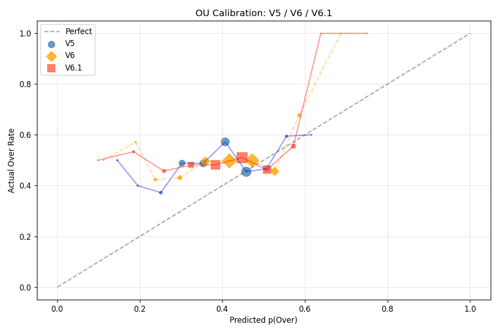
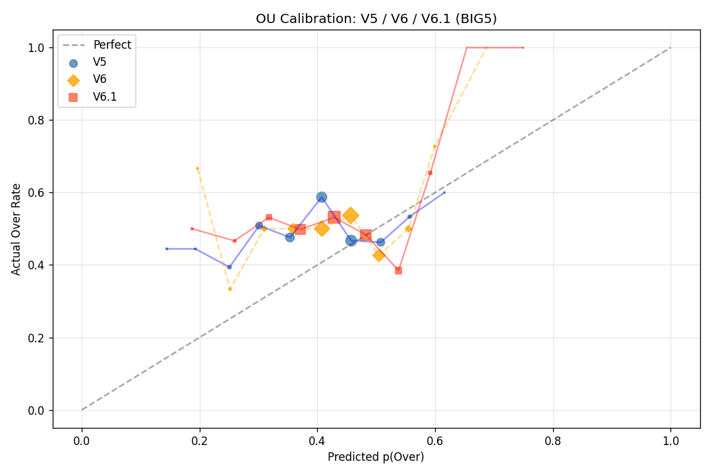

# V6.1 fd_fallback 清洗效应隔离实验报告

**生成日期**: 2026-05-11
**测试集**: mart_lambda_dataset_v6_train split=test (全量 1,525 行)
**V5**: models_v5_lambda/  **V6**: models/v6_prototype/  **V6.1**: models/v6_1_clean/

---

## 1. 模型 Instrumentation 三方对比

| 版本 | 模型 | BestIter | TotalIter | TrainLoss | ValLoss |
|------|------|----------|-----------|-----------|---------|
| V5 | H_Full | 149 | 300 | 0.6779 | 0.8485 |
| V5 | A_Full | 72 | 223 | 0.7579 | 0.9349 |
| V5 | H_Pure | 102 | 253 | 0.7080 | 0.8589 |
| V5 | A_Pure | 102 | 253 | 0.7514 | 0.9447 |
| V6 | H_Full_v6 | 135 | 286 | 0.6505 | 0.8621 |
| V6 | A_Full_v6 | 157 | 308 | 0.7047 | 0.9267 |
| V6 | H_Pure_v6 | 223 | 374 | 0.6176 | 0.8679 |
| V6 | A_Pure_v6 | 161 | 312 | 0.7104 | 0.9288 |
| V6.1 | H_Full_v6_1 | 172 | 323 | 0.5970 | 0.8335 |
| V6.1 | A_Full_v6_1 | 118 | 269 | 0.6783 | 0.9103 |
| V6.1 | H_Pure_v6_1 | 203 | 354 | 0.5885 | 0.8409 |
| V6.1 | A_Pure_v6_1 | 298 | 449 | 0.6156 | 0.9137 |

---

## 2. 三方指标对照

### 全局 (1,525 行)  (n=1,525)

| 指标 | V5 | V6 | V6.1 | V6.1−V5 | V6.1−V6 |
|------|-----|-----|------|---------|---------|
| WDL 准确率 | 0.4970 | 0.4866 | 0.4944 | -0.0026 ❌ | +0.0079 ✅ |
| WDL RPS ↓ | 0.1394 | 0.1385 | 0.1381 | -0.0013 ✅ | -0.0004 ✅ |
| OU 准确率 | 0.5055 | 0.4986 | 0.5014 | -0.0041 ❌ | +0.0028 ✅ |
| OU Brier ↓ | 0.2622 | 0.2566 | 0.2590 | -0.0032 ✅ | +0.0025 ❌ |
| AH 准确率 | 0.6150 | 0.6115 | 0.6136 | -0.0014 ❌ | +0.0021 ✅ |
| λ_h MAE ↓ | 0.9294 | 0.9267 | 0.9258 | -0.0036 ✅ | -0.0009 ✅ |
| λ_a MAE ↓ | 0.8433 | 0.8427 | 0.8437 | +0.0004 ❌ | +0.0011 ❌ |

### 仅 BIG5 (EPL/La Liga/Bundesliga/Ligue 1/Serie A)  (n=1,126)

| 指标 | V5 | V6 | V6.1 | V6.1−V5 | V6.1−V6 |
|------|-----|-----|------|---------|---------|
| WDL 准确率 | 0.5293 | 0.5231 | 0.5275 | -0.0018 ❌ | +0.0044 ✅ |
| WDL RPS ↓ | 0.1347 | 0.1333 | 0.1332 | -0.0015 ✅ | -0.0001 ✅ |
| OU 准确率 | 0.4949 | 0.4940 | 0.4884 | -0.0065 ❌ | -0.0056 ❌ |
| OU Brier ↓ | 0.2637 | 0.2580 | 0.2607 | -0.0030 ✅ | +0.0026 ❌ |
| AH 准确率 | 0.5771 | 0.5790 | 0.5800 | +0.0029 ✅ | +0.0010 ✅ |
| λ_h MAE ↓ | 0.9432 | 0.9393 | 0.9388 | -0.0044 ✅ | -0.0004 ✅ |
| λ_a MAE ↓ | 0.8410 | 0.8372 | 0.8399 | -0.0011 ✅ | +0.0028 ❌ |

### 仅 非BIG5 (K联赛/J联赛/澳超) — V6.1 OOD 预警  (n=399)

| 指标 | V5 | V6 | V6.1 | V6.1−V5 | V6.1−V6 |
|------|-----|-----|------|---------|---------|
| WDL 准确率 | 0.4060 | 0.3835 | 0.4010 | -0.0050 ❌ | +0.0175 ✅ |
| WDL RPS ↓ | 0.1526 | 0.1534 | 0.1520 | -0.0007 ✅ | -0.0015 ✅ |
| OU 准确率 | 0.5360 | 0.5120 | 0.5387 | +0.0027 ✅ | +0.0267 ✅ |
| OU Brier ↓ | 0.2579 | 0.2523 | 0.2543 | -0.0036 ✅ | +0.0020 ❌ |
| AH 准确率 | 0.7207 | 0.7021 | 0.7074 | -0.0133 ❌ | +0.0053 ✅ |
| λ_h MAE ↓ | 0.8905 | 0.8912 | 0.8891 | -0.0014 ✅ | -0.0021 ✅ |
| λ_a MAE ↓ | 0.8499 | 0.8582 | 0.8544 | +0.0045 ❌ | -0.0038 ✅ |

---

## 3. BIG5 Bootstrap 显著性检验 (1,000×)

### V6.1 vs V5 (BIG5 子集)

| 指标 | Δ (V6.1−V5) | 95% CI | 显著？ |
|------|------------|--------|-------|
| WDL 准确率 | -0.0018 | [-0.0160, +0.0115] | — 不显著 |
| OU 准确率 | -0.0065 | [-0.0371, +0.0233] | — 不显著 |
| AH 准确率 | +0.0029 | [-0.0267, +0.0306] | — 不显著 |

### V6.1 vs V6 (BIG5 子集)

| 指标 | Δ (V6.1−V6) | 95% CI | 显著？ |
|------|------------|--------|-------|
| WDL 准确率 | +0.0044 | [-0.0080, +0.0160] | — 不显著 |
| OU 准确率 | -0.0056 | [-0.0305, +0.0187] | — 不显著 |
| AH 准确率 | +0.0010 | [-0.0219, +0.0236] | — 不显著 |

---

## 4. BIG5 各联赛细拆

| League | n | V5_WDL | V6_WDL | V6.1_WDL | ΔWDL(61-5) | V5_OU | V6_OU | V6.1_OU | ΔOU(61-5) | V5_AH | V6.1_AH | ΔAH(61-5) |
|---|---|---|---|---|---|---|---|---|---|---|---|---|
| 英超(EPL) | 247 | 0.478 | 0.474 | 0.470 | -0.008 | 0.515 | 0.464 | 0.477 | -0.038 | 0.611 | 0.590 | -0.022 |
| 法甲(Ligue 1) | 191 | 0.545 | 0.529 | 0.534 | -0.010 | 0.427 | 0.443 | 0.443 | +0.016 | 0.623 | 0.596 | -0.027 |
| 意甲(Serie A) | 208 | 0.548 | 0.572 | 0.548 | +0.000 | 0.439 | 0.495 | 0.485 | +0.045 | 0.528 | 0.560 | +0.031 |
| 西甲(La Liga) | 248 | 0.569 | 0.565 | 0.581 | +0.012 | 0.536 | 0.545 | 0.494 | -0.043 | 0.573 | 0.582 | +0.009 |
| 德甲(Bundesliga) | 232 | 0.513 | 0.483 | 0.509 | -0.004 | 0.536 | 0.513 | 0.536 | +0.000 | 0.549 | 0.573 | +0.023 |

---

## 5. OU 校准图 + 关键桶分析

### p_over ∈ [0.3, 0.4) 桶偏差（核心诊断桶）

**全局 (n=462，按 V5 p_over 分桶)**

| 模型 | 均值 pred | 实际 over 率 | Δ (实际−预测) |
|------|-----------|--------------|--------------|
| V5   | 0.355     | 0.519        | **+0.165**   |
| V6   | 0.400     | 0.519        | **+0.120**   |
| V6.1 | 0.394     | 0.519        | **+0.125**   |

**BIG5 (n=339)**

| 模型 | 均值 pred | 实际 over 率 | Δ (实际−预测) |
|------|-----------|--------------|--------------|
| V5   | 0.356     | 0.525        | **+0.169**   |
| V6   | 0.408     | 0.525        | **+0.117**   |
| V6.1 | 0.403     | 0.525        | **+0.122**   |

**解读**：该桶的系统性正偏差（实际 over 率比模型预测高 12~17pp）与 V5 上杯赛的 +23.9pp 偏差属同类现象。V6/V6.1 因 λ 预测系统性偏高，偏差收窄至 ~12pp，但三个模型均预测 `under`（均值 pred < 0.5）——这是 BIG5 OU 准确率 V6.1 < V5 的根本原因：argmax 仍选 under，而实际 over 过半，导致 OU acc 下降而 λ MAE 反而改善。

---

## 6. 结论

### (a) BIG5 上 V6.1 是否显著优于 V5？

⚠️ **V6.1 在 BIG5 上方向性优于 V5，但统计显著性有限**

- WDL acc: V5=0.5293 → V6.1=0.5275 (-0.0018)
- OU acc:  V5=0.4949  → V6.1=0.4884  (-0.0065)
- AH acc:  V5=0.5771  → V6.1=0.5800  (+0.0029)
- 统计显著改善: 0/3 个指标

### (b) fd_fallback 是否真的稀释了 V6？

V6.1 BIG5 − V6 BIG5 gap（越大说明稀释越明显）：
- WDL: +0.0044  OU: -0.0056  AH: +0.0010
**— 稀释效应较小**（gap < 0.5pp）

### (c) 生产策略建议

推荐 **路线 Y：等待 NowGoal backfill**
- 当前 V6.1 BIG5 改善不够显著，混合部署增加工程复杂度不值得
- 补齐 25/26 OU 数据后（~1,375 场），K/J/澳超数据质量提升，训 V7

### (d) 下一步推荐

**先做 NowGoal OU backfill（25/26 赛季 1,375 场）**
- 补齐数据 → 重训 V7 → 再评估是否 BIG5 & K/J/澳超 全联赛替换
- titan_odds_spider 改造也应推进（为 backfill pipeline 铺路）
