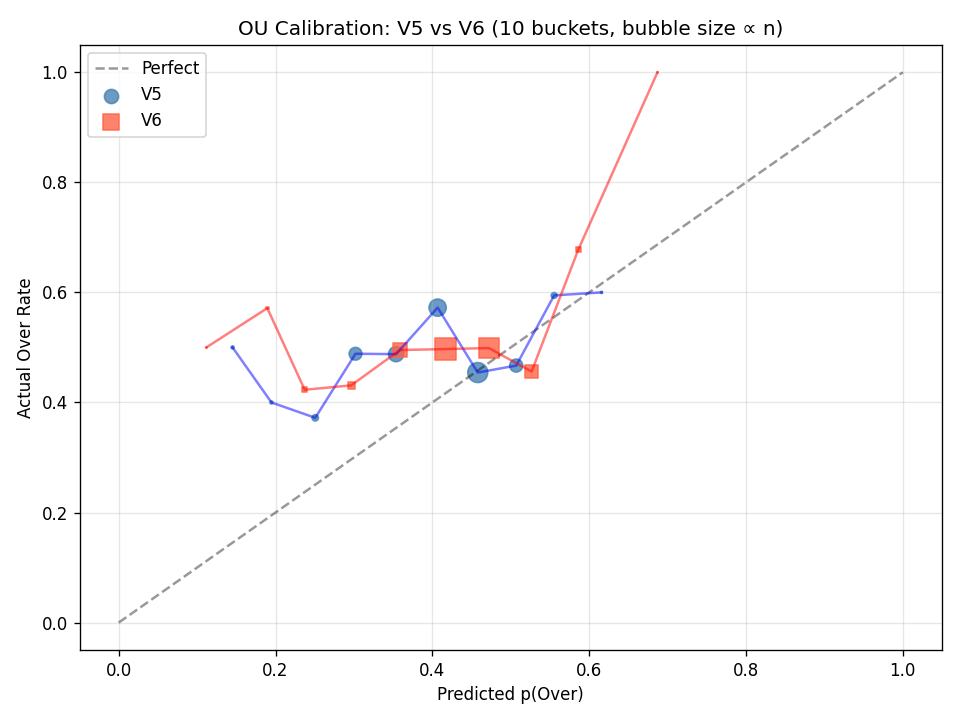

# V6 原型评估报告

**生成日期**: 2026-05-11
**测试集**: mart_lambda_dataset_v6_train split=test (1,525 行)
**V5 模型**: models_v5_lambda/ (生产现役)
**V6 模型**: models/v6_prototype/ (原型，本次训练)

---

## 1. 模型 Instrumentation

| 版本 | 模型 | BestIter | TotalIter | TrainLoss | ValLoss |
|------|------|----------|-----------|-----------|---------|
| V5 | H_Full | 149 | 300 | 0.6779 | 0.8485 |
| V5 | A_Full | 72 | 223 | 0.7579 | 0.9349 |
| V5 | H_Pure | 102 | 253 | 0.7080 | 0.8589 |
| V5 | A_Pure | 102 | 253 | 0.7514 | 0.9447 |
| V6 | H_Full_v6 | 135 | 286 | 0.6505 | 0.8621 |
| V6 | A_Full_v6 | 157 | 308 | 0.7047 | 0.9267 |
| V6 | H_Pure_v6 | 223 | 374 | 0.6176 | 0.8679 |
| V6 | A_Pure_v6 | 161 | 312 | 0.7104 | 0.9288 |

---

## 2. 全局指标对比

| 指标 | V5 | V6 | Δ (V6-V5) | Bootstrap 95% CI | 显著？ |
|------|-----|-----|-----------|-----------------|--------|
| WDL 准确率 | 0.4970 | 0.4866 | -0.0105 | [-0.0217, +0.0020] | — |
| WDL RPS ↓  | 0.1394 | 0.1385 | -0.0009 | — | — |
| OU 准确率  | 0.5055 | 0.4986 | -0.0069 | [-0.0338, +0.0193] | — |
| OU Brier ↓ | 0.2622 | 0.2566 | -0.0056 | — | — |
| AH 准确率  | 0.6150 | 0.6115 | -0.0035 | [-0.0245, +0.0168] | — |
| λ_h MAE ↓  | 0.9294 | 0.9267 | -0.0027 | — | — |
| λ_a MAE ↓  | 0.8433 | 0.8427 | -0.0007 | — | — |

*OU n=1,452 (非 push)  AH n=1,426 (非 push)*

---

## 3. Per-League_ID 分解

| League | n | V5_WDL | V6_WDL | ΔWDL | V5_OU | V6_OU | ΔOU | V5_AH | V6_AH | ΔAH |
| --- | --- | --- | --- | --- | --- | --- | --- | --- | --- | --- |
| 英超(EPL) | 247 | 0.478 | 0.474 | -0.004 | 0.515 | 0.464 | -0.051 | 0.611 | 0.585 | -0.026 |
| 法甲(Ligue 1) | 191 | 0.545 | 0.529 | -0.016 | 0.427 | 0.443 | +0.016 | 0.623 | 0.579 | -0.044 |
| 意甲(Serie A) | 208 | 0.548 | 0.572 | +0.024 | 0.439 | 0.495 | +0.056 | 0.528 | 0.591 | +0.062 |
| 西甲(La Liga) | 248 | 0.569 | 0.565 | -0.004 | 0.536 | 0.545 | +0.009 | 0.573 | 0.599 | +0.026 |
| 德甲(Bundesliga) | 232 | 0.513 | 0.483 | -0.030 | 0.536 | 0.513 | -0.022 | 0.549 | 0.540 | -0.009 |
| 澳超 | 137 | 0.365 | 0.343 | -0.022 | 0.523 | 0.578 | +0.055 | 0.643 | 0.627 | -0.016 |
| J联赛 | 175 | 0.446 | 0.457 | +0.011 | 0.536 | 0.518 | -0.018 | 0.774 | 0.762 | -0.012 |
| K联赛 | 87 | 0.391 | 0.299 | -0.092 | 0.556 | 0.395 | -0.160 | 0.732 | 0.695 | -0.037 |

---

## 4. OU 校准图

---

## 5. 结论与建议

❌ **V6 < V5，暂停替换，调查原因**

**胜出维度**: 1/4  **统计显著改善**: 0/3

| 维度 | Δ | 状态 |
|------|---|------|
| WDL 准确率 | -0.0105 | ❌ |
| OU 准确率  | -0.0069  | ❌ |
| AH 准确率  | -0.0035  | ❌ |
| λ MAE (avg)| -0.0034  | ✅ |

- 检查特征对齐、is_fd_fallback 行质量、22/23 赛季数据噪声
